<h1 align="center">Hi 👋, I'm Adithya Herath</h1>
<h3 align="center">Computer Science undergraduate at NSBM · Full-stack, IoT & Game Developer from Sri Lanka 🇱🇰</h3>

  
   🎏 Want your own koi pond? <a href="https://github.com/AdithyaHerath/koi-Pond">Get it here</a> · <a href="https://adithyaherath.github.io/koi-Pond/">Try the demo</a>

🎏 <b>What is this pond?</b> Every contribution feeds my koi — click to see the milestones

 

My koi started as a tiny pale hatchling. Every commit, PR and issue helps it grow, and each milestone brings something new to the pond. It updates automatically twice a day using <a href="https://github.com/marketplace/actions/koi-pond-profile">Koi Pond Profile</a> from the GitHub Marketplace.

| Contributions | Stage | What happens in the pond |
| --- | --- | --- |
| 0 | 🥚 HATCHLING | A tiny pale koi hatches in a quiet pond |
| 25 | 🐟 FRY | First orange scale · lily pads drift in |
| 100 | 🎏 YOUNG | Red Kohaku markings · reeds grow at the edges |
| 250 | 🐠 JUVENILE | Black sumi spots · a friend joins · pebbles settle |
| 500 | 🪷 ADULT | Blue back scales · lotus flowers bloom · a third koi |
| 1,000 | 🌕 ELDER | Metallic shimmer · the moon rises · fireflies |
| 2,000 | 🌸 LEGEND | Golden fins · sakura petals fall · a school of four |
| 5,000 | 🐉 DRAGON | The koi climbed the waterfall and became a dragon |

- 🎓 Computer Science undergraduate at **NSBM Green University**
- 🔭 Working on an **IoT Smart Parking System** (ESP32 + ANPR + cloud dashboard)
- 🌱 Currently learning **Game Development** with Unity & Blender
- 💬 Ask me about **Python, JavaScript, React and IoT**

 

## 🛠️ Languages & Tools

**Languages**

  

**Web & Backend**

  

**AI / ML, Mobile, IoT & Game Dev**

  

**Tools**

  

## 🚀 Featured Projects

| Project | Description | Tech |
| --- | --- | --- |
| [Smart Parking System](https://github.com/AdithyaHerath/smart-parking-system) | IoT parking management with ANPR, ESP32 devices, real-time slot availability and digital payments | TypeScript · ESP32 · IoT |
| [Math Battle Arena](https://github.com/AdithyaHerath/math-battle-arena) | Math battle game | Dart · Flutter |
| [Web Forum](https://github.com/AdithyaHerath/web-forum) | Discussion forum web app | PHP |
| [Project Fullstack](https://github.com/AdithyaHerath/project-fullstack) | Full-stack web application | TypeScript · JavaScript · mongodb |
| [Christmas Glitch](https://github.com/AdithyaHerath/christmas-glitch) | Interactive holiday page with glitch animation and falling snow | HTML · CSS · JS |
| [GPA Calculator](https://github.com/AdithyaHerath/GPA-Calculator) | Simple GPA calculator | HTML |

## ☕ Support

